# CheStoria

**Point. Snap. Story.** A native iOS app that turns any corner of Naples (and a day in Pompeii) into a question, a short verified story and a detail to find.

<p>
    
</p>
<p>
 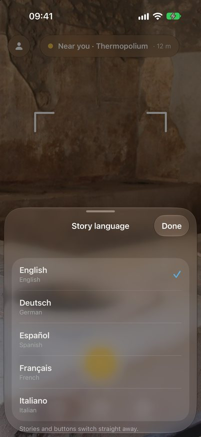  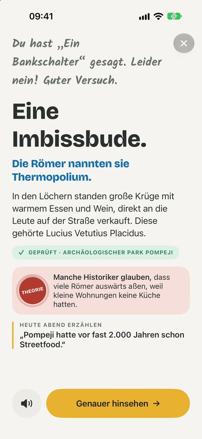 
</p>
<p>
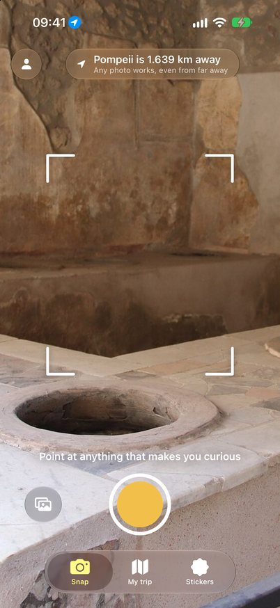 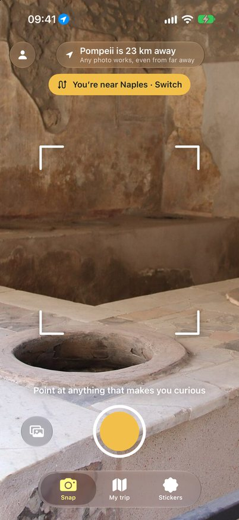 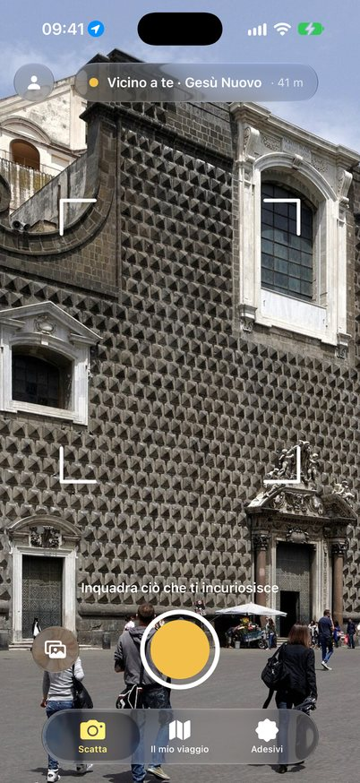 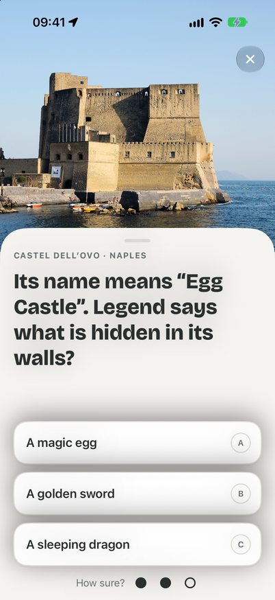 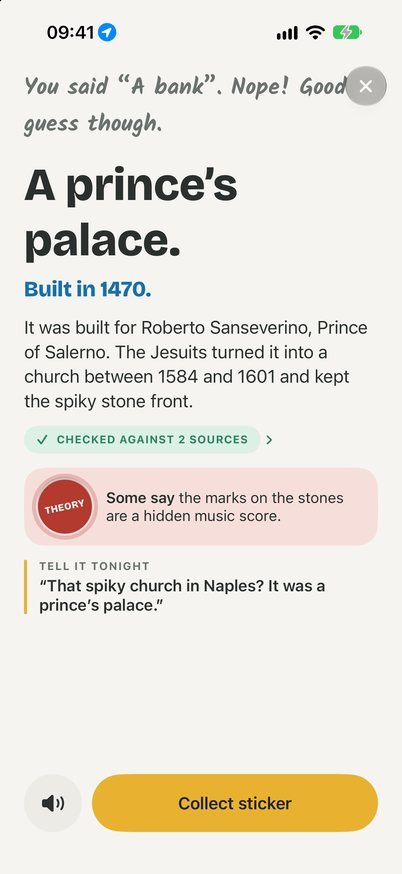
</p>
<p>
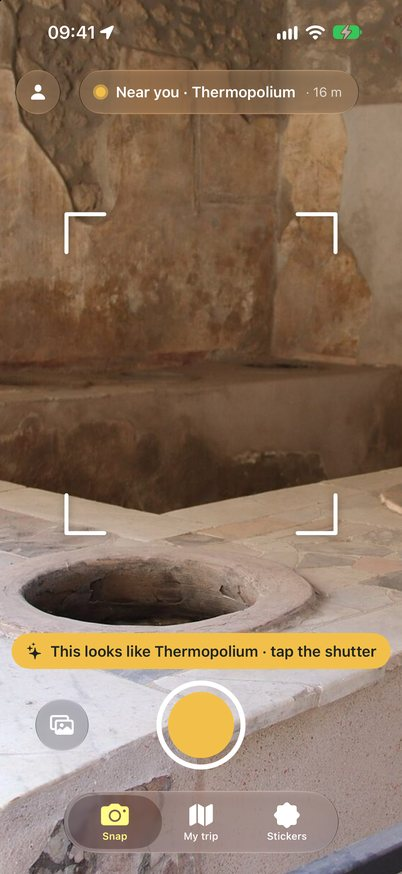 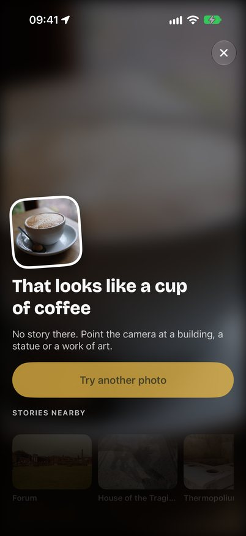 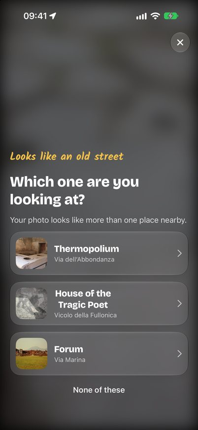 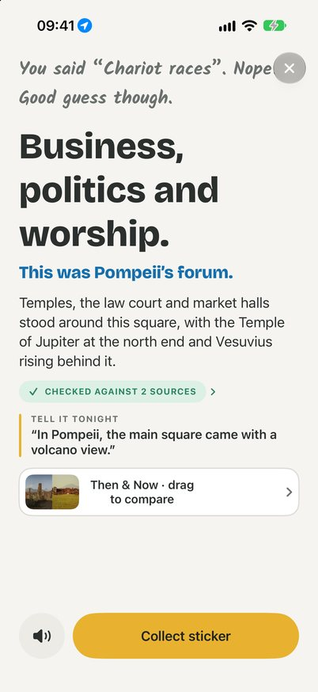 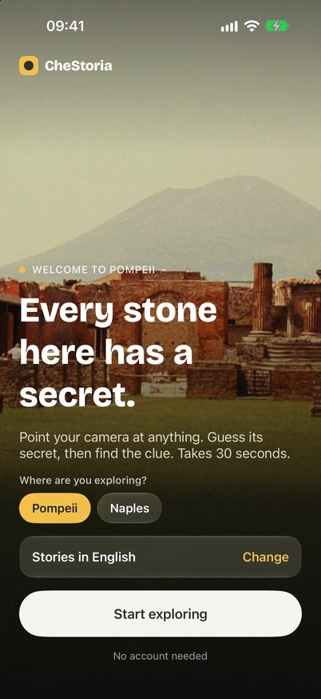 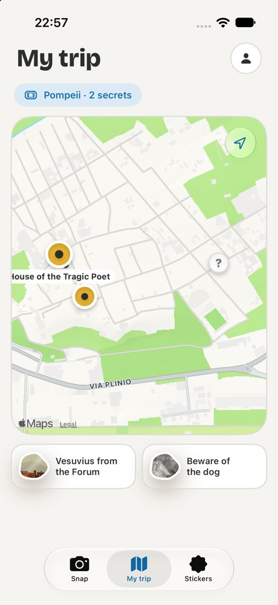
</p>
<p>
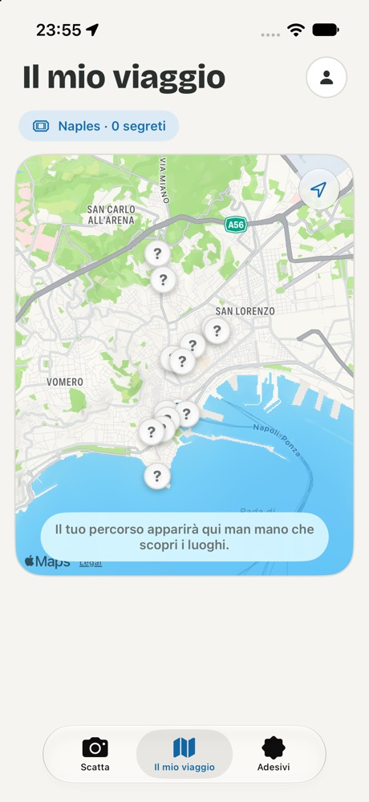 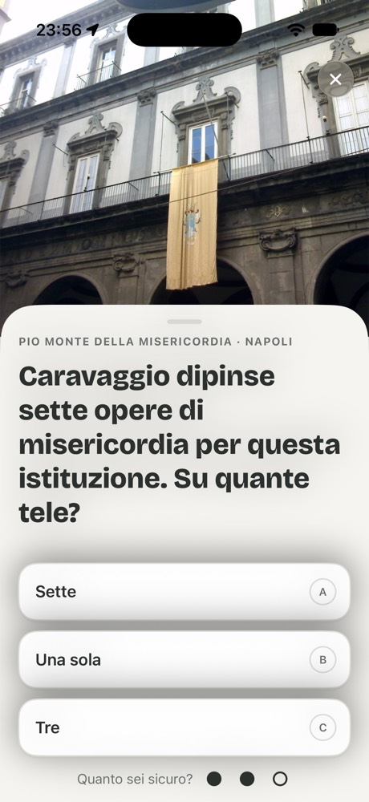 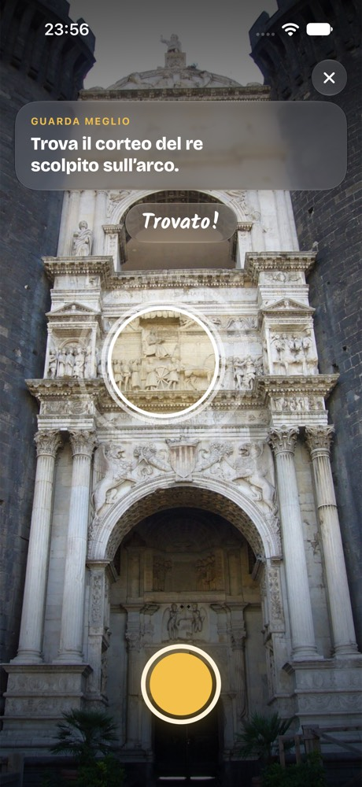
</p>

## The loop

1. **Snap**: point the camera at a place. GPS already knows where you are, so there is nothing to search.
2. **Question first**: "Romans queued at this counter every day. What was it?" A question before the answer makes it stick.
3. **Reveal**: about 30 words and 2 facts, with a clear source. Legends and theories wear a red seal.
4. **Look closer**: hunt for one detail on the real object. Haptic pulses speed up as you get close.
5. **Sticker**: your detail photo becomes a die-cut sticker; the back holds one line to retell at dinner.
6. **Next morning**: one quiet recall question in Notification Center (provisional, no permission prompt).

Every design decision maps to the team's research: the language gap, little time and attention, the freedom to explore, and the curiosity gap (2 facts beat 8).

## What's in this version

- **Five languages**: English, Italiano, Français, Deutsch, Español. Change them on the welcome screen or in Profile. Stories, buttons and read-aloud all switch at once, and trip progress is kept.
- **On-device AI recognition (real time)**: Google's SigLIP model (Apache-2.0) runs on the phone with Core ML. While you aim, the Snap screen says what it sees ("I see a church façade", or "This looks like Gesù Nuovo · tap the shutter"). After a photo it opens the right story, asks "Which one is it?" when two places are close (with "None of these"), or says kindly what the photo shows ("That looks like a cup of coffee") when it isn't a place. No internet, no account, no cost per photo.
- **Profile and accounts**: Sign in with Apple, or email and password. Passwords are salted and hashed (PBKDF2-SHA256) and kept in the Keychain. Profile also has settings (language, haptics, next-morning question, read aloud), sign-out and account deletion.
- **Everything is content**: places, stories, maps, welcome text, tickets, translations and interface text are JSON. See [CONTENT.md](CONTENT.md).
- **Two sites**: Pompeii with 19 stories (Forum, Thermopolium, House of the Tragic Poet, Amphitheatre, Large and Small Theatres, Basilica, Mensa Ponderaria, Castellum Aquae, Central and Stabian Baths, Houses of the Faun, Vettii, Octavius Quartio, Casca Longus and the Moralist, Villa of the Mysteries, Lupanar, a bakery) plus 52 more places shown as "story coming soon" pins; read-aloud is off in Pompeii until the Park confirms it is allowed (visitor rules, art. 6). Naples with 13 places: Gesù Nuovo, Piazza del Plebiscito (car-park Then & Now), Cappella Sansevero, Castel dell’Ovo, Santa Chiara, Teatro di San Carlo (engraving Then & Now), Castel Nuovo, Galleria Umberto I (engraving Then & Now), Pio Monte della Misericordia, the Bourbon Tunnel, the Catacombs of San Gennaro and San Gaudioso, and the Treasure of San Gennaro. Indoor, ticketed and underground places are map-only: no camera, they open from the map or when you stand there, and directions lead to the real entrance. Switch in Profile; the app offers to switch when you are standing in the other site. Each site keeps its own trip.
- **Fact-checked**: every story lists its sources (tap the green pill). The validator refuses a story without sources. "Verified" is reserved for facts confirmed by the site itself; everything else says "Checked against N sources".
- **Apple Maps trip map**: your route between the places you found, "?" pins for stories still to find, your live position, and walking directions from any place card. Pins come from each place's coordinates in the content.
- **Honest location**: the Snap chip shows the real nearest place and distance, "Finding where you are…", "Location is off", or "Pompeii is 1,639 km away". It never invents a distance.
- **Live Activity and widget**: "Secret 30 m ahead" appears on the Lock Screen and in the Dynamic Island when an unseen story is within 150 m. A "Yesterday’s question" widget shows the recall question and its result.
- **Next-morning question**: answer it straight from the notification. You get "✓ Bar! You remembered." (or the right answer) at once, and it counts towards "Remembered" in Profile.
- **Accounts that can sync**: on-device accounts by default; set `SupabaseURL` and `SupabaseAnonKey` in `project.yml` and the same screens use Supabase Auth (email, password, Sign in with Apple, account deletion).

## Run it

Requirements: Xcode 26 or later, iOS 26 SDK (the app uses Liquid Glass).

```sh
open CheStoria.xcodeproj        # then Run on an iPhone simulator
```

The project is generated from `project.yml` with [XcodeGen](https://github.com/yonaskolb/XcodeGen). After adding or moving files, run `xcodegen generate`.

In the simulator there is no camera, so the Snap screen shows the place's photo with a gentle hand-held drift. On a device it uses the live camera.

Run the tests with `⌘U`, or:

```sh
xcodebuild test -project CheStoria.xcodeproj -scheme CheStoria -destination 'platform=iOS Simulator,name=iPhone 17'
```

### Debug launch arguments

Useful for demos and screenshots (Debug builds only):
- `-reset` starts a fresh trip; `-demo` loads the content’s demo trip (for presentations).
- `-capturePath /path/photo.jpg` runs recognition on any photo file (simulator).
- `-place forum` picks the place for `-screen reveal` and friends.
- `-lang it` switches the story language. `-site naples` switches site.
- `-noLocation` skips location (the chip then says "Finding where you are…").
- `-screen <name>` jumps to `welcome`, `snap`, `recognizing`, `question`, `reveal`, `closer`, `sticker`, `trip`, `stickers`, `profile` or `language`.
- `-capture <asset>` runs real recognition on a bundled photo, e.g. `-capture caveCanem`.
- `-autosolve` finishes the Look closer hunt by itself.

## Project layout

```
CheStoria/
  App/            entry point, root view, tabs, debug launch arguments
  Design/         palette (Naples stone colours), typefaces, motion
  Model/          content types and loader (languages, remote updates, cache), validator, AppModel
  Services/       recognition (Vision + fallback), location, camera, accounts (Keychain, Sign in with Apple), haptics, read-aloud, recall
  Components/     photos from assets or URLs, die-cut stickers, glass chips, buttons, theory seal, reticle
  Features/       Onboarding, Snap, Story (recognise → choose → question → reveal → look closer → sticker), Trip, Stickers, Profile
  Resources/      Content/ (catalog, sites, translations, interface strings), photos, fonts
CheStoriaWidgets/ Live Activity ("Secret nearby") and the "Yesterday’s question" widget
Shared/           types shared by the app and the widget extension (App Group store, activity attributes)
CheStoriaTests/   content in every language, recognition (Pompeii, Naples, unseen photos), location honesty, sites, accounts (local + Supabase), framing, hunt, trip state
tools/            import_places.py (partner CSV/JSON), import_story_cards.py (research story cards), embed_content.py (AI text)
design/           CheStoria.sketch, animated HTML prototype, design direction page
```

Content lives in `CheStoria/Resources/Content/`, not in code; [CONTENT.md](CONTENT.md) explains how to add places, languages and sites. A test fails if any language has broken content or a story body over 40 words.

## The AI model, and why this one

| Option | Licence | Verdict |
|---|---|---|
| **Google SigLIP base (used)** | Apache-2.0, commercial use allowed | Strong photo↔photo and photo↔text matching; 70 MB on device after 6-bit compression (cosine ≥ 0.985 vs the original) |
| Apple Vision built-in classifier | Part of iOS | Free, but generic labels only and can’t learn our places |
| Apple MobileCLIP / FastVLM | Apple ML Research licence (non-commercial only) | Not usable in a product |
| OpenAI CLIP | Model card rules out deployed use | Avoided |
| SmolVLM2 (Hugging Face) | Apache-2.0 | Can describe any photo in a sentence; a 0.5–1 GB download, good for a later "describe this" feature |

How it works: the app ships only SigLIP’s image encoder (`CheStoria/Resources/ML`). Reference photos of each place are embedded on the phone; each place’s plain-English `aiDescriptions` and a vocabulary of ~50 everyday and heritage things are embedded offline by `tools/embed_content.py` and shipped as content. A photo is compared with all of them; thresholds live in each site’s `recognition` block. Measured on photos the app has never seen: a different Cave canem photo opens its story (0.83 vs 0.51), a crowded Forum photo is offered first, an unrelated street is never matched with confidence, and coffee and laptop photos are named correctly in all five languages. See `CheStoria/Resources/ML/NOTICE.md` for the licence notice.

## Accounts

The app talks to an `AuthService` protocol. This version ships `LocalAuthService`: accounts live on the device, in the Keychain, which suits user testing and offline use. To sync accounts across devices, implement `AuthService` against your backend (Firebase, Supabase or your own API) and pass it to `AccountModel` in `CheStoriaApp`. No view changes are needed. Sign in with Apple needs the capability enabled for your team, which `project.yml` already requests.

## Design

- **Colours** come from the city: Piperno (ink), Tufo (rewards only), Azzurro (interactive), Maiolica (verified facts only), Pompei red (legends and theories, never wrong answers), Calce (backgrounds). Light and dark variants are in the asset catalog.
- **Type**: Bricolage Grotesque ExtraBold for questions and answers, SF Pro for story text (Dynamic Type, every language), Kalam for one-line reactions.
- **Motion**: springs for answers, pins and stickers; everything respects Reduce Motion.
- References from Apple Design Award winners: CapWords (stickers), Flighty (Live Activities), Any Distance (collectibles), Duolingo (press feedback without streak guilt), Bears Gratitude (hand-drawn warmth), Crouton (one thing per screen), Oko (haptics you can use without looking), Gentler Streak (no-guilt tone).

Open `design/CheStoria.sketch` after installing the fonts in `CheStoria/Resources/Fonts`. Open `design/prototype/index.html` in a browser for the animated walkthrough.

## Before launch (needs people, not code)

- **Site confirmation**: stories are checked against published sources (listed in each story). Before launch, ask the Pompeii Archaeological Park and the Naples sites to confirm them; then set `"status": "verified"` and the pill reads "Verified".
- **Native-speaker review** of the Italian, French, German and Spanish text.
- **On-site recognition tuning**: walk the sites, take photos, read Profile → Recognition log, and adjust the site’s `recognition` block in the content. Add 3–4 reference photos per place.
- **The rest of Pompeii and Naples** from a licensed data export (`tools/import_places.py`).
- **Supabase project**: create one, add Apple as a provider, run the `delete_user` SQL in `SupabaseAuth.swift`, and fill in the two keys.
- **Signing**: App Groups (widget data) and Sign in with Apple are requested in `project.yml`; Xcode registers them for your team on the first device build.

## Credits

Photos and fonts are listed in [CREDITS.md](CREDITS.md).
