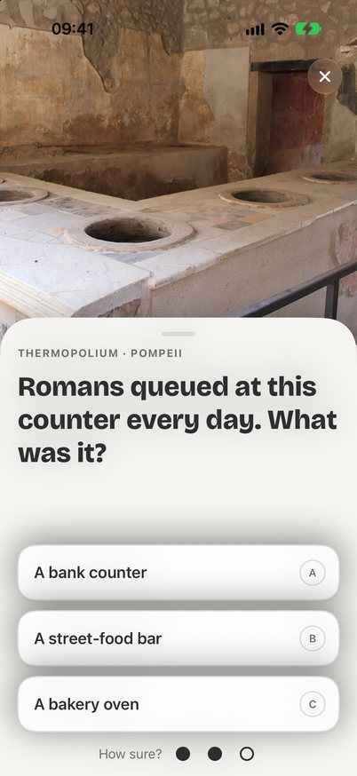

# CheStoria

**Point. Snap. Story.** A native iOS app that turns any corner of Naples (and a day in Pompeii) into a question, a short verified story and a detail to find.

<p>
    
</p>

## The loop

1. **Snap**: point the camera at a place. GPS already knows where you are, so there is nothing to search.
2. **Question first**: "Romans queued at this counter every day. What was it?" A question before the answer makes it stick.
3. **Reveal**: about 30 words and 2 facts, with a clear source. Legends and theories wear a red seal.
4. **Look closer**: hunt for one detail on the real object. Haptic pulses speed up as you get close.
5. **Sticker**: your detail photo becomes a die-cut sticker; the back holds one line to retell at dinner.
6. **Next morning**: one quiet recall question in Notification Center (provisional, no permission prompt).

Every design decision maps to the team's research: the language gap, little time and attention, the freedom to explore, and the curiosity gap (2 facts beat 8).

## Run it

Requirements: Xcode 26 or later, iOS 26 SDK (the app uses Liquid Glass).

```sh
open CheStoria.xcodeproj        # then Run on an iPhone simulator
```

The project is generated from `project.yml` with [XcodeGen](https://github.com/yonaskolb/XcodeGen). After adding or moving files, run `xcodegen generate`.

In the simulator there is no camera, so the Snap screen shows the place's photo with a gentle hand-held drift. On a device it uses the live camera.

Run the tests with `⌘U`, or:

```sh
xcodebuild test -project CheStoria.xcodeproj -scheme CheStoria -destination 'platform=iOS Simulator,name=iPhone 17'
```

### Debug launch arguments

Useful for demos and screenshots (Debug builds only): `-reset` restores the demo trip, `-screen <name>` jumps to `welcome`, `snap`, `recognizing`, `question`, `reveal`, `closer`, `sticker`, `trip` or `stickers`, and `-autosolve` finishes the Look closer hunt by itself.

## Project layout

```
CheStoria/
  App/            entry point, root view, tabs, debug launch arguments
  Design/         palette (Naples stone colours), typefaces, motion
  Model/          content types, AppModel (trip state, persisted in UserDefaults)
  Services/       place recognition (location), camera, haptics, read-aloud, recall notification
  Components/     cover-framed photos, die-cut stickers, glass chips, buttons, theory seal, reticle
  Features/       Onboarding, Snap, Story (recognising → question → reveal → look closer → sticker), Trip, Stickers
  Resources/      pompeii.json (all story content), photos, fonts
CheStoriaTests/   content checks, framing maths, hunt feedback, trip state
design/           CheStoria.sketch, animated HTML prototype, design direction page
```

Story content lives in `CheStoria/Resources/pompeii.json`, not in code. A test fails if a story body grows past 40 words.

## Design

- **Colours** come from the city: Piperno (ink), Tufo (rewards only), Azzurro (interactive), Maiolica (verified facts only), Pompei red (legends and theories, never wrong answers), Calce (backgrounds). Light and dark variants are in the asset catalog.
- **Type**: Bricolage Grotesque ExtraBold for questions and answers, SF Pro for story text (Dynamic Type, every language), Kalam for one-line reactions.
- **Motion**: springs for answers, pins and stickers; everything respects Reduce Motion.
- References from Apple Design Award winners: CapWords (stickers), Flighty (Live Activities), Any Distance (collectibles), Duolingo (press feedback without streak guilt), Bears Gratitude (hand-drawn warmth), Crouton (one thing per screen), Oko (haptics you can use without looking), Gentler Streak (no-guilt tone).

Open `design/CheStoria.sketch` after installing the fonts in `CheStoria/Resources/Fonts`. Open `design/prototype/index.html` in a browser for the animated walkthrough.

## Not built yet

- Real visual recognition (Vision / Core ML) to break ties when places are close together; today recognition is location only.
- The Live Activity ("Secret 30 m ahead") and a widget, which need a widget extension target.
- Handling the answer from the recall notification inside the app.
- Naples stories and more Pompeii places; localised story text.
- A content pipeline with fact-checking. **The Pompeii story text here is sample copy and must be verified with the park before launch.**

## Credits

Photos and fonts are listed in [CREDITS.md](CREDITS.md).
