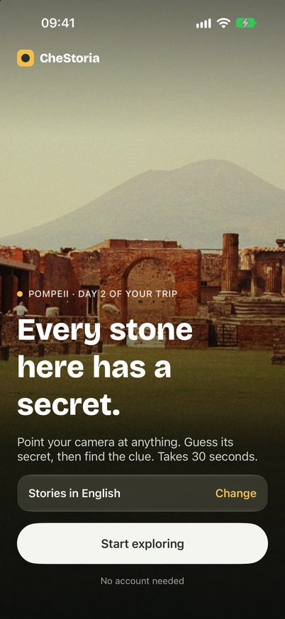
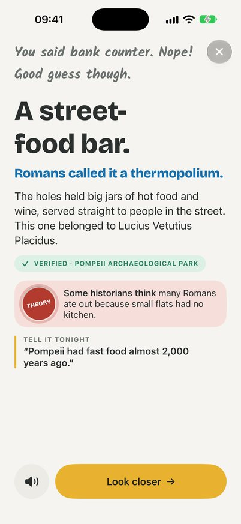
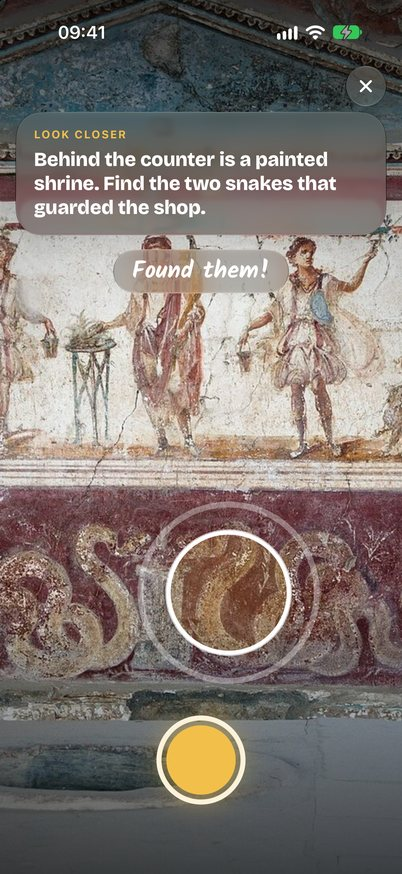

# CheStoria

**Point. Snap. Story.** A native iOS app that turns any corner of Naples (and a day in Pompeii) into a question, a short verified story and a detail to find.

<p>
    
</p>
<p>
    
</p>

## The loop

1. **Snap**: point the camera at a place. GPS already knows where you are, so there is nothing to search.
2. **Question first**: "Romans queued at this counter every day. What was it?" A question before the answer makes it stick.
3. **Reveal**: about 30 words and 2 facts, with a clear source. Legends and theories wear a red seal.
4. **Look closer**: hunt for one detail on the real object. Haptic pulses speed up as you get close.
5. **Sticker**: your detail photo becomes a die-cut sticker; the back holds one line to retell at dinner.
6. **Next morning**: one quiet recall question in Notification Center (provisional, no permission prompt).

Every design decision maps to the team's research: the language gap, little time and attention, the freedom to explore, and the curiosity gap (2 facts beat 8).

## What's in this version

- **Five languages**: English, Italiano, Français, Deutsch, Español. Change them on the welcome screen or in Profile. Stories, buttons and read-aloud all switch at once, and trip progress is kept.
- **Photo recognition**: your photo is compared with each place's reference photos on the device, with location narrowing the candidates. Different photos lead to different stories; if it's unsure, the app asks "Which one are you looking at?". There's a photo picker next to the shutter for the simulator or for photos you already took.
- **Profile and accounts**: Sign in with Apple, or email and password. Passwords are salted and hashed (PBKDF2-SHA256) and kept in the Keychain. Profile also has settings (language, haptics, next-morning question, read aloud), sign-out and account deletion.
- **Everything is content**: places, stories, maps, welcome text, tickets, translations and interface text are JSON. See [CONTENT.md](CONTENT.md).

## Run it

Requirements: Xcode 26 or later, iOS 26 SDK (the app uses Liquid Glass).

```sh
open CheStoria.xcodeproj        # then Run on an iPhone simulator
```

The project is generated from `project.yml` with [XcodeGen](https://github.com/yonaskolb/XcodeGen). After adding or moving files, run `xcodegen generate`.

In the simulator there is no camera, so the Snap screen shows the place's photo with a gentle hand-held drift. On a device it uses the live camera.

Run the tests with `⌘U`, or:

```sh
xcodebuild test -project CheStoria.xcodeproj -scheme CheStoria -destination 'platform=iOS Simulator,name=iPhone 17'
```

### Debug launch arguments

Useful for demos and screenshots (Debug builds only):
- `-reset` restores the demo trip.
- `-lang it` switches the story language.
- `-screen <name>` jumps to `welcome`, `snap`, `recognizing`, `question`, `reveal`, `closer`, `sticker`, `trip`, `stickers`, `profile` or `language`.
- `-capture <asset>` runs real recognition on a bundled photo, e.g. `-capture caveCanem`.
- `-autosolve` finishes the Look closer hunt by itself.

## Project layout

```
CheStoria/
  App/            entry point, root view, tabs, debug launch arguments
  Design/         palette (Naples stone colours), typefaces, motion
  Model/          content types and loader (languages, remote updates, cache), validator, AppModel
  Services/       recognition (Vision + fallback), location, camera, accounts (Keychain, Sign in with Apple), haptics, read-aloud, recall
  Components/     photos from assets or URLs, die-cut stickers, glass chips, buttons, theory seal, reticle
  Features/       Onboarding, Snap, Story (recognise → choose → question → reveal → look closer → sticker), Trip, Stickers, Profile
  Resources/      Content/ (catalog, sites, translations, interface strings), photos, fonts
CheStoriaTests/   content in every language, recognition on unseen photos, accounts, framing, hunt, trip state
tools/            import_places.py: import points of interest from a partner's CSV/JSON export
design/           CheStoria.sketch, animated HTML prototype, design direction page
```

Content lives in `CheStoria/Resources/Content/`, not in code; [CONTENT.md](CONTENT.md) explains how to add places, languages and sites. A test fails if any language has broken content or a story body over 40 words.

## Accounts

The app talks to an `AuthService` protocol. This version ships `LocalAuthService`: accounts live on the device, in the Keychain, which suits user testing and offline use. To sync accounts across devices, implement `AuthService` against your backend (Firebase, Supabase or your own API) and pass it to `AccountModel` in `CheStoriaApp`. No view changes are needed. Sign in with Apple needs the capability enabled for your team, which `project.yml` already requests.

## Design

- **Colours** come from the city: Piperno (ink), Tufo (rewards only), Azzurro (interactive), Maiolica (verified facts only), Pompei red (legends and theories, never wrong answers), Calce (backgrounds). Light and dark variants are in the asset catalog.
- **Type**: Bricolage Grotesque ExtraBold for questions and answers, SF Pro for story text (Dynamic Type, every language), Kalam for one-line reactions.
- **Motion**: springs for answers, pins and stickers; everything respects Reduce Motion.
- References from Apple Design Award winners: CapWords (stickers), Flighty (Live Activities), Any Distance (collectibles), Duolingo (press feedback without streak guilt), Bears Gratitude (hand-drawn warmth), Crouton (one thing per screen), Oko (haptics you can use without looking), Gentler Streak (no-guilt tone).

Open `design/CheStoria.sketch` after installing the fonts in `CheStoria/Resources/Fonts`. Open `design/prototype/index.html` in a browser for the animated walkthrough.

## Not built yet

- Tuning recognition thresholds on site with real visitor photos, and more reference photos per place.
- A server-backed `AuthService` for accounts that sync across devices.
- The Live Activity ("Secret 30 m ahead") and a widget, which need a widget extension target.
- Handling the answer from the recall notification inside the app.
- Naples stories and the rest of Pompeii, from a licensed data export (see CONTENT.md).
- A content pipeline with fact-checking. **The Pompeii story text and its translations are sample copy and must be verified with the Park before launch.**

## Credits

Photos and fonts are listed in [CREDITS.md](CREDITS.md).
