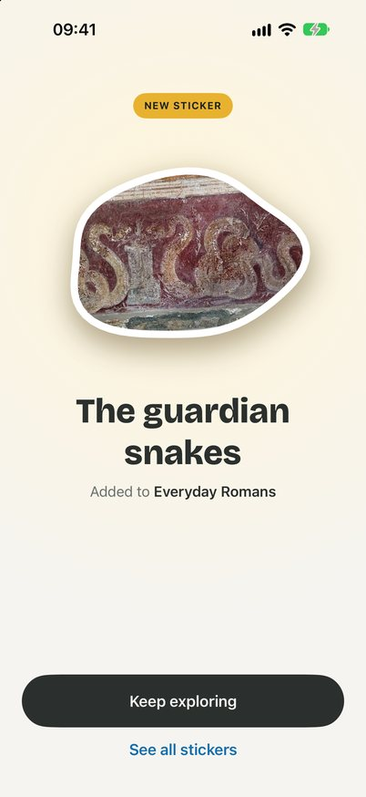
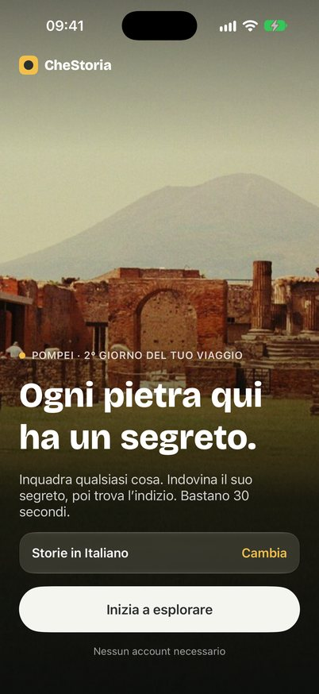
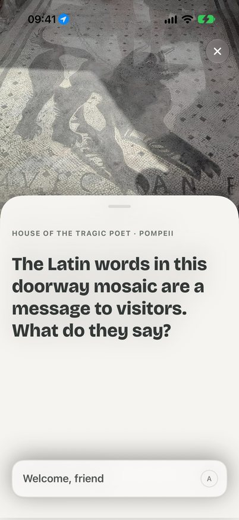
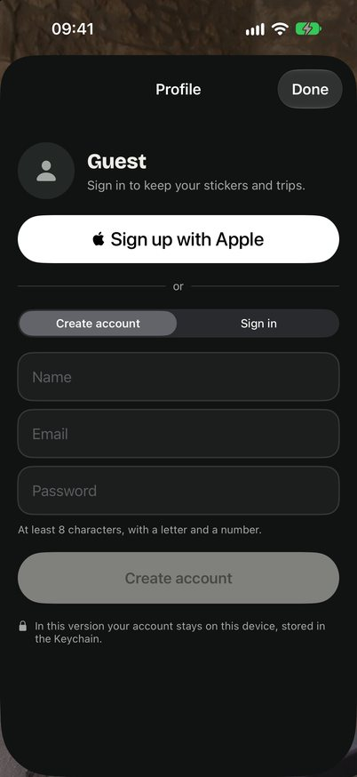

# CheStoria

**Point. Snap. Story.** A native iOS app that turns any corner of Naples (and a day in Pompeii) into a question, a short verified story and a detail to find.

<p>
    
</p>
<p>
    
</p>
<p>
    
</p>

## The loop

1. **Snap**: point the camera at a place. GPS already knows where you are, so there is nothing to search.
2. **Question first**: "Romans queued at this counter every day. What was it?" A question before the answer makes it stick.
3. **Reveal**: about 30 words and 2 facts, with a clear source. Legends and theories wear a red seal.
4. **Look closer**: hunt for one detail on the real object. Haptic pulses speed up as you get close.
5. **Sticker**: your detail photo becomes a die-cut sticker; the back holds one line to retell at dinner.
6. **Next morning**: one quiet recall question in Notification Center (provisional, no permission prompt).

Every design decision maps to the team's research: the language gap, little time and attention, the freedom to explore, and the curiosity gap (2 facts beat 8).

## What's in this version

- **Five languages**: English, Italiano, Français, Deutsch, Español. Change them on the welcome screen or in Profile. Stories, buttons and read-aloud all switch at once, and trip progress is kept.
- **Photo recognition**: your photo is compared with each place's reference photos on the device, with location narrowing the candidates. Different photos lead to different stories; if it's unsure, the app asks "Which one are you looking at?". There's a photo picker next to the shutter for the simulator or for photos you already took.
- **Profile and accounts**: Sign in with Apple, or email and password. Passwords are salted and hashed (PBKDF2-SHA256) and kept in the Keychain. Profile also has settings (language, haptics, next-morning question, read aloud), sign-out and account deletion.
- **Everything is content**: places, stories, maps, welcome text, tickets, translations and interface text are JSON. See [CONTENT.md](CONTENT.md).
- **Two sites**: Pompeii (Forum, Thermopolium, House of the Tragic Poet) and Naples (Gesù Nuovo, Piazza del Plebiscito with a real car-park Then & Now, Cappella Sansevero, Castel dell’Ovo). Switch in Profile; the app offers to switch when you are standing in the other site. Each site keeps its own trip.
- **Fact-checked**: every story lists its sources (tap the green pill). The validator refuses a story without sources. "Verified" is reserved for facts confirmed by the site itself; everything else says "Checked against N sources".
- **Honest location**: the Snap chip shows the real nearest place and distance, "Finding where you are…", "Location is off", or "Pompeii is 1,639 km away". It never invents a distance.
- **Live Activity and widget**: "Secret 30 m ahead" appears on the Lock Screen and in the Dynamic Island when an unseen story is within 150 m. A "Yesterday’s question" widget shows the recall question and its result.
- **Next-morning question**: answer it straight from the notification. You get "✓ Bar! You remembered." (or the right answer) at once, and it counts towards "Remembered" in Profile.
- **Accounts that can sync**: on-device accounts by default; set `SupabaseURL` and `SupabaseAnonKey` in `project.yml` and the same screens use Supabase Auth (email, password, Sign in with Apple, account deletion).

## Run it

Requirements: Xcode 26 or later, iOS 26 SDK (the app uses Liquid Glass).

```sh
open CheStoria.xcodeproj        # then Run on an iPhone simulator
```

The project is generated from `project.yml` with [XcodeGen](https://github.com/yonaskolb/XcodeGen). After adding or moving files, run `xcodegen generate`.

In the simulator there is no camera, so the Snap screen shows the place's photo with a gentle hand-held drift. On a device it uses the live camera.

Run the tests with `⌘U`, or:

```sh
xcodebuild test -project CheStoria.xcodeproj -scheme CheStoria -destination 'platform=iOS Simulator,name=iPhone 17'
```

### Debug launch arguments

Useful for demos and screenshots (Debug builds only):
- `-reset` restores the demo trip.
- `-lang it` switches the story language. `-site naples` switches site.
- `-noLocation` skips location (the chip then says "Finding where you are…").
- `-screen <name>` jumps to `welcome`, `snap`, `recognizing`, `question`, `reveal`, `closer`, `sticker`, `trip`, `stickers`, `profile` or `language`.
- `-capture <asset>` runs real recognition on a bundled photo, e.g. `-capture caveCanem`.
- `-autosolve` finishes the Look closer hunt by itself.

## Project layout

```
CheStoria/
  App/            entry point, root view, tabs, debug launch arguments
  Design/         palette (Naples stone colours), typefaces, motion
  Model/          content types and loader (languages, remote updates, cache), validator, AppModel
  Services/       recognition (Vision + fallback), location, camera, accounts (Keychain, Sign in with Apple), haptics, read-aloud, recall
  Components/     photos from assets or URLs, die-cut stickers, glass chips, buttons, theory seal, reticle
  Features/       Onboarding, Snap, Story (recognise → choose → question → reveal → look closer → sticker), Trip, Stickers, Profile
  Resources/      Content/ (catalog, sites, translations, interface strings), photos, fonts
CheStoriaWidgets/ Live Activity ("Secret nearby") and the "Yesterday’s question" widget
Shared/           types shared by the app and the widget extension (App Group store, activity attributes)
CheStoriaTests/   content in every language, recognition (Pompeii, Naples, unseen photos), location honesty, sites, accounts (local + Supabase), framing, hunt, trip state
tools/            import_places.py: import points of interest from a partner's CSV/JSON export
design/           CheStoria.sketch, animated HTML prototype, design direction page
```

Content lives in `CheStoria/Resources/Content/`, not in code; [CONTENT.md](CONTENT.md) explains how to add places, languages and sites. A test fails if any language has broken content or a story body over 40 words.

## Accounts

The app talks to an `AuthService` protocol. This version ships `LocalAuthService`: accounts live on the device, in the Keychain, which suits user testing and offline use. To sync accounts across devices, implement `AuthService` against your backend (Firebase, Supabase or your own API) and pass it to `AccountModel` in `CheStoriaApp`. No view changes are needed. Sign in with Apple needs the capability enabled for your team, which `project.yml` already requests.

## Design

- **Colours** come from the city: Piperno (ink), Tufo (rewards only), Azzurro (interactive), Maiolica (verified facts only), Pompei red (legends and theories, never wrong answers), Calce (backgrounds). Light and dark variants are in the asset catalog.
- **Type**: Bricolage Grotesque ExtraBold for questions and answers, SF Pro for story text (Dynamic Type, every language), Kalam for one-line reactions.
- **Motion**: springs for answers, pins and stickers; everything respects Reduce Motion.
- References from Apple Design Award winners: CapWords (stickers), Flighty (Live Activities), Any Distance (collectibles), Duolingo (press feedback without streak guilt), Bears Gratitude (hand-drawn warmth), Crouton (one thing per screen), Oko (haptics you can use without looking), Gentler Streak (no-guilt tone).

Open `design/CheStoria.sketch` after installing the fonts in `CheStoria/Resources/Fonts`. Open `design/prototype/index.html` in a browser for the animated walkthrough.

## Before launch (needs people, not code)

- **Site confirmation**: stories are checked against published sources (listed in each story). Before launch, ask the Pompeii Archaeological Park and the Naples sites to confirm them; then set `"status": "verified"` and the pill reads "Verified".
- **Native-speaker review** of the Italian, French, German and Spanish text.
- **On-site recognition tuning**: walk the sites, take photos, read Profile → Recognition log, and adjust the site’s `recognition` block in the content. Add 3–4 reference photos per place.
- **The rest of Pompeii and Naples** from a licensed data export (`tools/import_places.py`).
- **Supabase project**: create one, add Apple as a provider, run the `delete_user` SQL in `SupabaseAuth.swift`, and fill in the two keys.
- **Signing**: App Groups (widget data) and Sign in with Apple are requested in `project.yml`; Xcode registers them for your team on the first device build.

## Credits

Photos and fonts are listed in [CREDITS.md](CREDITS.md).
